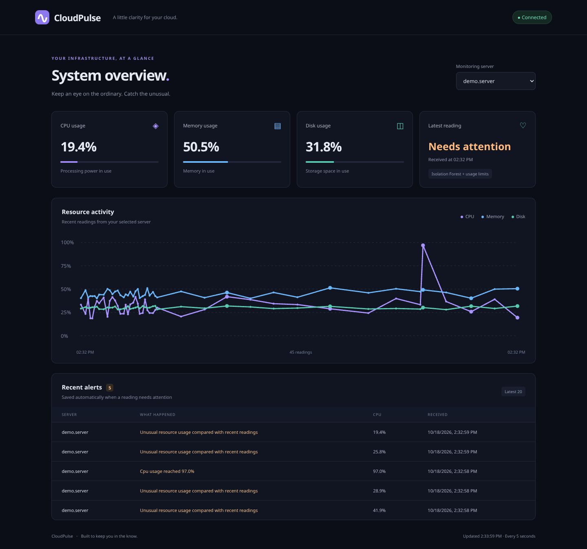

# CloudPulse

**Intelligent Cloud Monitoring & Anomaly Detection Platform**

CloudPulse tracks CPU, memory, and disk usage across your servers. Pick a server, watch its recent activity, and check the alerts when something looks off.

**Python · FastAPI · PostgreSQL · Scikit-learn · AWS CloudWatch · Docker**



## How it works

A Python agent collects readings and sends them to the API. The app saves them, checks for anomalies, and updates the dashboard every five seconds. The frontend is plain HTML, CSS, and JavaScript.

Each server gets its own baseline. After 30 readings, Isolation Forest compares new activity with the last 200 readings. Usage at 90% or above triggers an alert straight away. Alerts stay in the dashboard; there are no email or SMS notifications yet. Unusual doesn't always mean broken, so the model's flags still need a human look.

## Run it

You'll need Python 3.12. The local version uses SQLite.

```bash
python -m venv .venv
source .venv/bin/activate
pip install -r requirements.txt
uvicorn app.main:app --reload
```

Open `http://localhost:8000`. For the API, head to `/docs`.

Activate the same environment in another terminal. Run `python demo.py` to try the dashboard with sample readings and a CPU spike, or `python agent.py` to collect real readings from your machine.

## Docker

Copy `.env.example` to `.env`, set `POSTGRES_PASSWORD` to a URL safe password, then run:

```bash
docker compose up --build -d
```

This starts the app with PostgreSQL. Data stays in a Docker volume when you run `docker compose down`. Run the agent on the machine you want to monitor, outside the app container.

## EC2 readings

The AWS collector uses your existing AWS profile or role. It needs `cloudwatch:GetMetricStatistics` permission.

```bash
python aws_agent.py i-YOUR_INSTANCE_ID --region us-east-1
```

It checks CloudWatch every minute for new five minute CPU averages. Memory and disk stay blank because EC2 doesn't publish them by default. Chart timestamps show when CloudPulse received the data.

## A few things to know

Set `CLOUDPULSE_URL` for remote collectors and use the same `API_KEY` on the app and agents to protect uploads. Docker reads `.env`; Python commands read exported variables. SQLite and PostgreSQL have separate histories.

The dashboard and read APIs have no login yet. Keep them private until you've added authentication and HTTPS.

Run the tests with:

```bash
python -m pytest -q
```
